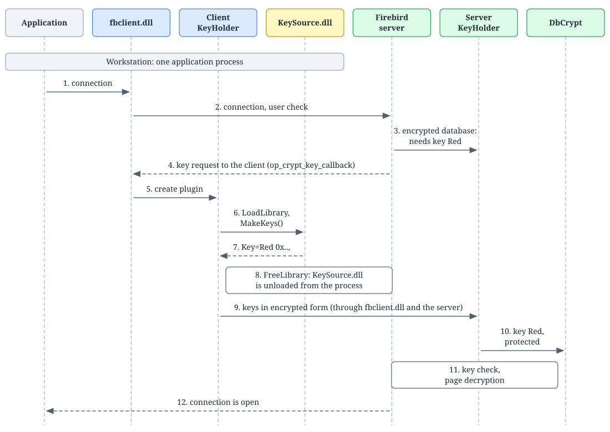

# Encryption for a closed-source GUI application

A full example for Windows and Firebird 3.0, 4.0, 5.0. The application does not change: the library `KeySource.dll` near `fbclient.dll` gives the encryption key.

The guide with diagrams:

- [read on GitHub](../../doc/en/fbcrypt-closed-gui.adoc): short text, reference data in the collapsible "Details" blocks;
- [fbcrypt-closed-gui-en.pdf](https://github.com/IBSurgeon/FirebirdEncryptionGuide/releases/latest/download/fbcrypt-closed-gui-en.pdf): full text, all blocks are open.



## Quick start

PowerShell, you do not need administrator rights. The installed Firebird instances do not change.

```powershell
cd deploy
Set-ExecutionPolicy -Scope Process Bypass
.\05-download-example.ps1
.\run-all.ps1 -Version 5
..\work\fb5\remote\EmployeeRemote.exe
```

The step `05-download-example.ps1` downloads the ready programs. If you have Lazarus, skip it: `run-all.ps1 -LazarusDir <Lazarus folder>` builds the programs itself.

The script `run-all.ps1`:

1. downloads Firebird from `github.com/FirebirdSQL/firebird` and the plugin with a trial license from `cc.ib-aid.com`;
2. installs a separate server in `work\fb5\server`, port 30055;
3. encrypts a copy of the `employee` database with the test key `Red`;
4. makes the workstation folder `work\fb5\remote` and the embedded folder `work\fb5\embedded`.

Other versions and variants: `-Version 3|4|5`, `-KeySource a|b|c|d`.

### With a pass phrase

```powershell
.\run-all.ps1 -Version 5 -AskPassphrase
..\work\fb5\remote\EmployeeRemote.exe
```

The script asks for a pass phrase and encrypts the database with it. It makes the workstation with variant `c`: at the first connection, a tray program in Windows asks for the phrase and keeps it in memory. The phrase is not on the disk.

If the example server is already installed, first run `.\cleanup.ps1 -Version 5`.

### Encrypted backup

```powershell
.\50-backup.ps1 -Version 5
```

The script makes a `gbak` backup that is also encrypted, and checks it with a test restore. On Firebird 4.0 and 5.0, the backup is encrypted only with the switch `-KEYHOLDER KeyHolder`; without it, `gbak` writes a file that is not encrypted and does not report an error.

## Contents

| Folder | What it contains |
|---|---|
| [app/EmployeeApp](app/EmployeeApp) | Lazarus application (SQLdb) without encryption code. Build modes `Remote` and `Embedded` |
| [keysource/a-static](keysource/a-static) | `KeySource.dll`: the key is written in the library |
| [keysource/b-file](keysource/b-file) | `KeySource.dll`: the key is read from a file |
| [keysource/c-provider](keysource/c-provider) | `KeySource.dll`: the program `KeyProvider.exe` gives the key through a named pipe |
| [keysource/d-rest](keysource/d-rest) | `KeySource.dll`: a REST service gives the key; cache in memory |
| [keysource/probe](keysource/probe) | Diagnostic library: writes each load and each call to the log |
| [keysource/common](keysource/common) | Common unit of the libraries |
| [keyprovider](keyprovider) | Key provider: a tray program in Windows, asks for the key and keeps it in memory |
| [restserver](restserver) | Demo key server in PowerShell |
| [deploy](deploy) | Scripts for download, installation, encryption, folder setup |
| [tests](tests) | Automatic test of all combinations |

## Test

```powershell
cd tests
.\run-matrix.ps1 -Negative -Load -Backup
```

Tested on 24.11.2026 on Windows 11 x64 with the official Firebird builds 3.0.14, 4.0.7, 5.0.4:

- key `Red`: 24 combinations (3 versions × usual connection and embedded × 4 `KeySource` variants);
- pass phrase: 18 combinations (variants `b`, `c`, `d`), also a phrase with Cyrillic text;
- 9 tests that must end with an error;
- encrypted backup and test restore for each version;
- load: 1000 connections in sequence and 8 threads for each variant (Firebird 5.0).

Not tested: 32-bit builds, the server as a Windows service, Linux, Delphi.

## Important

- The key `Red`, the password `masterkey` and the token `test-token` are known to everybody. Do not use them for real data.
- The trial license from the plugin archive is valid until the end of the current month. New archive: `.\02-download-plugin.ps1 -Version 5 -Force`.
- The scripts put the Firebird, plugin and license files in the folder `work`. These files do not go to the repository.
- The example server has no file `plugins\KeyHolder.conf`: the server keeps no keys. The script `20` writes the key line of the database to `work\fb<N>\db-key.conf` only so that the scripts `40` and `41` can set up the `KeySource` variants. With real data, such a file must not exist.
- Do not use the characters `#`, `"`, `{`, `}` and the sequence `$(` in a pass phrase.
