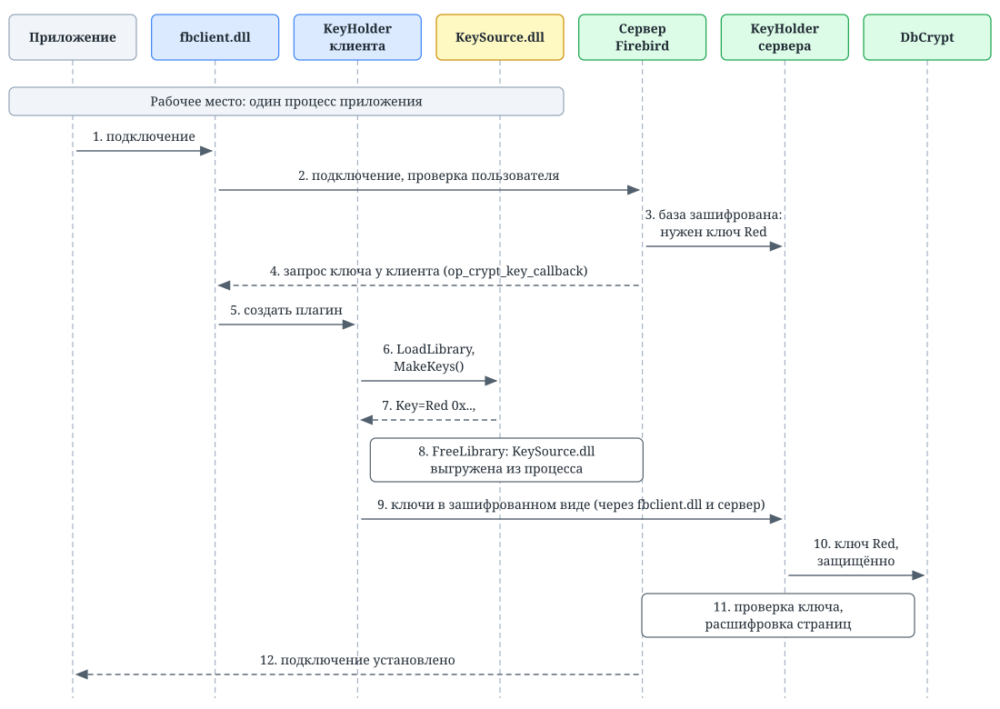

# Шифрование для GUI-приложения без исходных кодов

Полный пример для Windows и Firebird 3.0, 4.0, 5.0. Приложение не меняется: ключ шифрования передаёт библиотека `KeySource.dll`, которая лежит рядом с `fbclient.dll`.

Руководство с диаграммами:

- [читать на GitHub](../../doc/ru/fbcrypt-closed-gui.adoc): короткий текст, справочные сведения в раскрывающихся блоках «Подробности»;
- [fbcrypt-closed-gui.pdf](https://github.com/IBSurgeon/FirebirdEncryptionGuide/releases/latest/download/fbcrypt-closed-gui.pdf): полный текст, все блоки раскрыты.



## Быстрый старт

PowerShell, права администратора не нужны. Установленные экземпляры Firebird не меняются.

```powershell
cd deploy
Set-ExecutionPolicy -Scope Process Bypass
.\05-download-example.ps1
.\run-all.ps1 -Version 5
..\work\fb5\remote\EmployeeRemote.exe
```

Шаг `05-download-example.ps1` скачивает готовые программы. Если у вас есть Lazarus, пропустите его: `run-all.ps1 -LazarusDir <каталог Lazarus>` соберёт программы сам.

Скрипт `run-all.ps1`:

1. скачивает Firebird с `github.com/FirebirdSQL/firebird` и плагин с пробной лицензией с `cc.ib-aid.com`;
2. ставит отдельный сервер в `work\fb5\server`, порт 30055;
3. шифрует копию базы `employee` тестовым ключом `Red`;
4. собирает каталог рабочего места `work\fb5\remote` и каталог embedded `work\fb5\embedded`.

Другие версии и варианты: `-Version 3|4|5`, `-KeySource a|b|c|d`.

### С парольной фразой

```powershell
.\run-all.ps1 -Version 5 -AskPassphrase
..\work\fb5\remote\EmployeeRemote.exe
```

Скрипт спрашивает парольную фразу и шифрует ею базу данных. Рабочее место он собирает с вариантом `c`: при первом подключении программа в трее Windows спрашивает фразу и держит её в памяти. На диске фразы нет.

Если сервер примера уже установлен, сначала выполните `.\cleanup.ps1 -Version 5`.

### Зашифрованная резервная копия

```powershell
.\50-backup.ps1 -Version 5
```

Скрипт делает резервную копию `gbak`, которая тоже зашифрована, и проверяет её пробным восстановлением. На Firebird 4.0 и 5.0 копия шифруется только с переключателем `-KEYHOLDER KeyHolder`; без него `gbak` пишет незашифрованный файл и не сообщает об ошибке.

## Состав

| Каталог | Что в нём |
|---|---|
| [app/EmployeeApp](app/EmployeeApp) | Приложение Lazarus (SQLdb) без кода шифрования. Режимы сборки `Remote` и `Embedded` |
| [keysource/a-static](keysource/a-static) | `KeySource.dll`: ключ записан в библиотеке |
| [keysource/b-file](keysource/b-file) | `KeySource.dll`: ключ читается из файла |
| [keysource/c-provider](keysource/c-provider) | `KeySource.dll`: ключ даёт программа `KeyProvider.exe` через именованный канал |
| [keysource/d-rest](keysource/d-rest) | `KeySource.dll`: ключ даёт служба REST; кэш в памяти |
| [keysource/probe](keysource/probe) | Диагностическая библиотека: пишет в журнал каждую загрузку и каждый вызов |
| [keysource/common](keysource/common) | Общий модуль библиотек |
| [keyprovider](keyprovider) | Поставщик ключа: программа в трее Windows, спрашивает ключ и хранит его в памяти |
| [restserver](restserver) | Демо-сервер ключей на PowerShell |
| [deploy](deploy) | Скрипты скачивания, установки, шифрования, сборки каталогов |
| [tests](tests) | Автоматическая проверка всех сочетаний |

## Проверка

```powershell
cd tests
.\run-matrix.ps1 -Negative -Load -Backup
```

Проверено 24.11.2026 на Windows 11 x64 с официальными сборками Firebird 3.0.14, 4.0.7, 5.0.4:

- ключ `Red`: 24 сочетания (3 версии × обычное подключение и embedded × 4 варианта `KeySource`);
- парольная фраза: 18 сочетаний (варианты `b`, `c`, `d`), в том числе фраза с кириллицей;
- 9 проверок, которые должны закончиться ошибкой;
- зашифрованная резервная копия и пробное восстановление для каждой версии;
- нагрузка: 1000 подключений подряд и 8 потоков для каждого варианта (Firebird 5.0).

Не проверено: 32-битные сборки, сервер как служба Windows, Linux, Delphi.

## Важно

- Ключ `Red`, пароль `masterkey` и токен `test-token` открыты всем. Не используйте их для настоящих данных.
- Пробная лицензия из архива плагина действует до конца текущего месяца. Новый архив: `.\02-download-plugin.ps1 -Version 5 -Force`.
- Файлы Firebird, плагина и лицензии скрипты кладут в каталог `work`. В репозиторий они не попадают.
- На сервере примера нет файла `plugins\KeyHolder.conf`: ключей сервер не хранит. Строку ключа базы данных скрипт `20` записывает в `work\fb<N>\db-key.conf` только для того, чтобы скрипты `40` и `41` могли настроить варианты `KeySource`. С настоящими данными такого файла быть не должно.
- В парольной фразе нельзя использовать символы `#`, `"`, `{`, `}` и сочетание `$(`.
